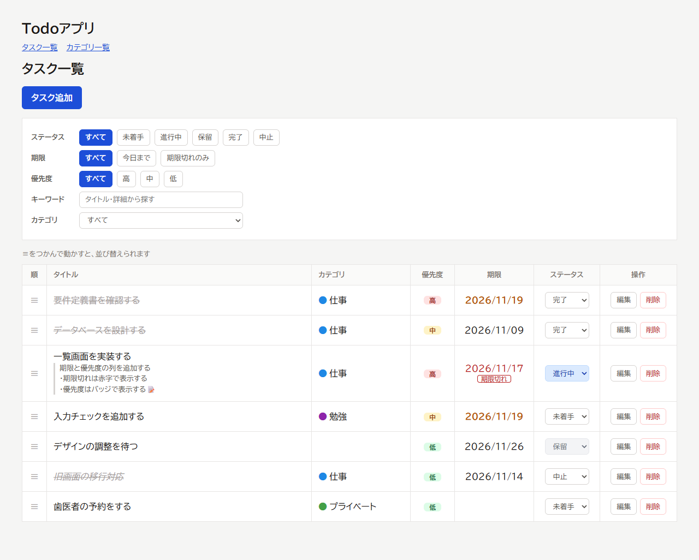
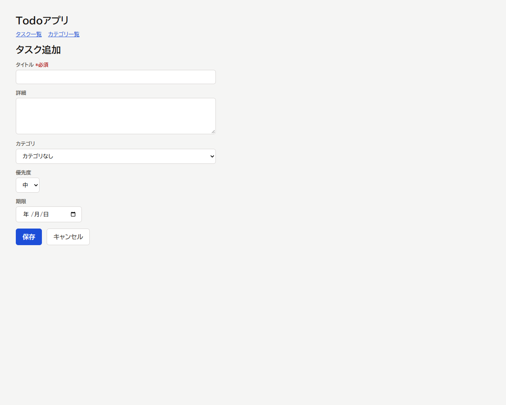
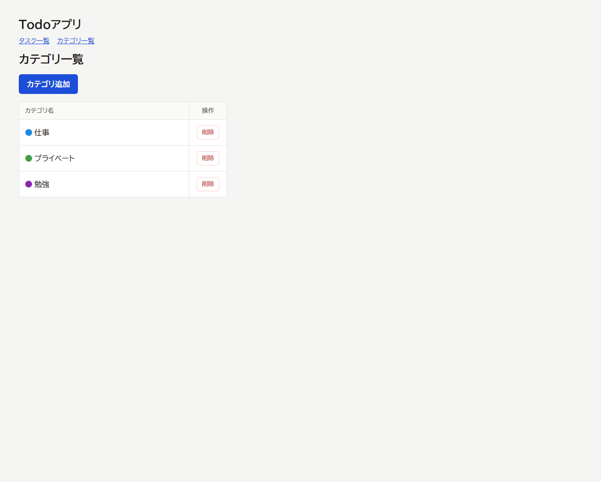
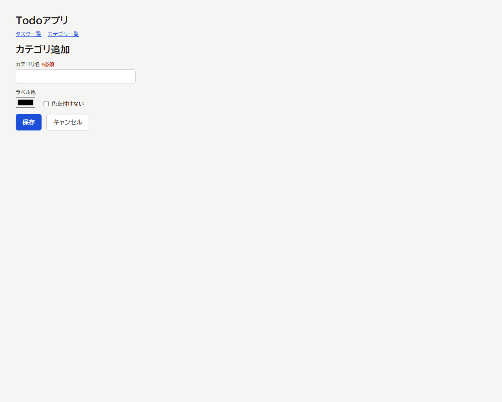

# Todoアプリ

Java 21 / Spring Boot / Thymeleafで作成したTodoアプリです。4つのフェーズに分けて段階的に開発しており、現在はフェーズ2（期限・優先度・絞り込み・分類・並び替え）まで実装しています。

## 機能

### タスク

- タスクの一覧・追加・編集・削除
- ステータス（未着手・進行中・保留・完了・中止）の変更
- 期限・優先度・詳細の入力と表示（期限切れと今日が期限を色で区別）
- ステータス・期限・優先度・カテゴリ・キーワードでの絞り込み（組み合わせ可）
- ドラッグでの並び替え（並び順は保存される）

### カテゴリ

- カテゴリの一覧・追加・削除（削除したカテゴリのタスクは「カテゴリなし」になる）
- カテゴリの色の印

## 画面

### タスク一覧



### タスク追加



### カテゴリ一覧



### カテゴリ追加



## 使用技術

- Java 21 / Spring Boot 3.5.16 / Thymeleaf 3.1.5
- JavaScript / jQuery 4.0.0 / jQuery UI 1.14.2
- MariaDB 12.3.3

## 開発フェーズ

1. タスクの一覧・追加・編集・削除とステータス管理
2. 期限・優先度・絞り込み・分類・並び替え
3. サブタスク・繰り返し
4. 認証・通知・API化

## 構成

```text
src/main/java/com/shinzato/todoapp/
  config/      設定(現在日時の取得に使うClockの登録、作成日時・更新日時をClockの現在日時で入れる監査の設定)
  controller/  画面用・API用のコントローラー
  service/     業務処理
  repository/  DBアクセス
  entity/      JPAエンティティ
  enums/       列挙型
  dto/         サービスの入力、絞り込みの条件、APIの入出力、一覧表示に使う読み取り専用のデータ
  form/        画面の入力フォームで扱うデータ
  mapper/      フォーム・APIのリクエスト・エンティティと、サービスのDTOとの詰め替え
  validation/  独自の入力チェック(存在するカテゴリのIDか)
  exception/   例外クラス・例外ハンドラー
src/main/resources/
  templates/   画面のHTML(Thymeleaf)
  static/      CSS・JavaScript
src/test/java/com/shinzato/todoapp/
               JUnitテスト
db/            DDL(データベース・テーブル定義)・動作確認用データ
  migration/   既存の環境を次のフェーズの形へ上げるSQL(番号順に実行する)
  manual-test/ 手動テストの準備のSQL(項目の番号ごと)
docs/
  manual-test.md  手動テストの手順(JUnitで検証できないブラウザ上の動作など)
  test-basis.md   テストケースの根拠(どの仕様をどのテストで確かめたか)
  test-results/   JUnitテストと手動テストの結果
```

## セットアップ

1. MariaDBで`db/01_schema.sql`を実行し、`tododb`データベースと`category`・`task`テーブルを作成する
2. MariaDBで`db/02_sample_data.sql`を実行し、動作確認用のカテゴリとタスクを登録する
3. アプリ接続用のDBユーザーを作成し、`tododb`への権限を付与する
4. `application-local.properties.example`を`application-local.properties`にコピーし、DB接続用のユーザーとパスワードを設定する
5. 次のコマンドで起動し、`http://localhost:8080/todo-app/tasks`にアクセスする
   - Windows: `.\mvnw.cmd spring-boot:run`
   - macOS・Linux: `./mvnw spring-boot:run`

終了するには、起動したターミナルで`Ctrl + C`を押す。

手順2で登録されるタスクには、5つのステータス、期限切れ・今日が期限・期限なし、3段階の優先度、改行と絵文字を含む詳細が含まれており、一覧画面で表示の違いを確認できる。期限は実行した日を基準に決まる。データが不要な場合は手順2を飛ばしてよい。

### フェーズ1の環境から更新する場合

フェーズ1の手順で`tododb`を作成した環境では、`01_schema.sql`・`02_sample_data.sql`は実行しない(表がすでにあるためエラーになる)。次のSQLを順に実行する。

1. `db/migration/phase2_upgrade_01.sql`(表の変更。登録済みのタスクは残り、優先度は「中」、表示順は登録した順になる)
2. `db/migration/phase2_upgrade_02.sql`(フェーズ1の`02_sample_data.sql`を実行していた場合だけ。サンプルデータを、新規の環境と同じ内容にそろえる)
